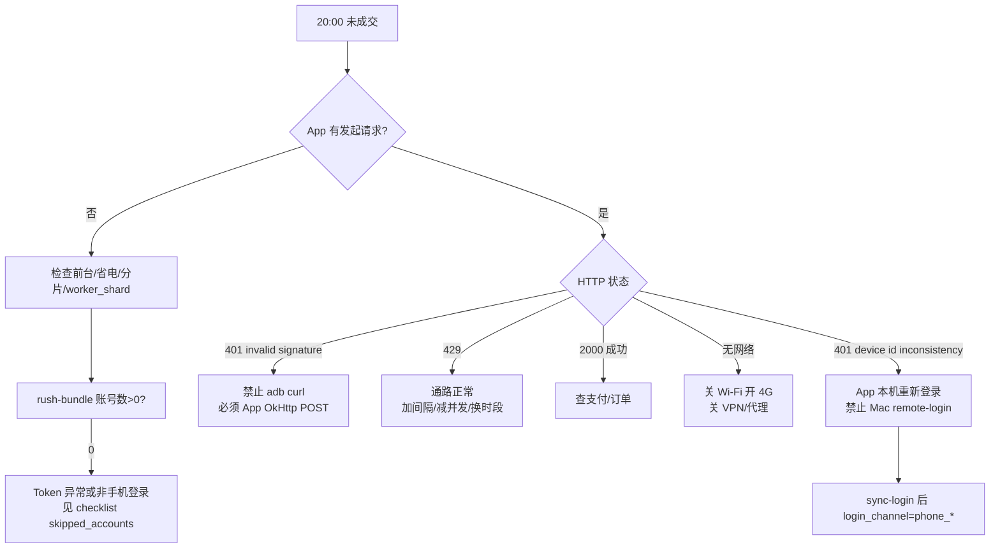

# 20:00 H5 平价飞天直购 · 失败决策树

> 主 KPI：**手机 4G + App 本机直购**。服务器仅负责 Shield 签名与数据存储。  
> **业务员 SOP** 见 [业务员手机操作指南.md](./业务员手机操作指南.md)（全程手机，无需 Mac）。

## 开战前 5 分钟（业务员 · 只用手机）

1. 关 Wi-Fi，确认 **4G/5G** 已开  
2. 打开管理 App → 首页 **「一键绑定本机」**  
3. 首页应显示 **待登录 0 · 可直购 ≥1 · act_id 有值**；否则去 **账号 → 待登录 → 本机发码**  
4. **19:55** 点 **「等到 20 点 · 本机直购」**，保持 App 前台  

服务器会在 **19:00** 自动刷新活动 ID、**19:50** 自动备战，业务员无需跑脚本。

## 运维调试（可选，非用户流程）

```bash
# 仅管理员 SSH 到服务器时使用
curl -H "Authorization: Bearer <token>" \
  'http://127.0.0.1:8000/api/v1/mobile/rush-readiness?worker_shard=phone-01'
```

Mac 上的 `pre_20_mobile_go.py` / `phone_connect_check.py`（ADB）仅供运维排查，**不要**交给业务员。

## 决策树



## 按现象处理

| 现象 | 根因 | 动作 |
|------|------|------|
| rush-bundle 0 账号 | Mac 登录 / Token 损坏 | App 逐号本机登录；6433 类 Padding 错误清 Token 重登 |
| 首轮 401 device | JWT deviceId ≠ H5 头 | 本机登录；勿混用 Mac batch 登录 |
| 服务器/Mac 429 | 公网 IP 限流 | **不要**服务器直购；仅手机 4G |
| 手机 429 | 频率或库存 | 保持 0.8s 错峰；429 说明通路 OK |
| Token 异常 4 个 | 仅计数 token_enc | 跑 `pre_20_checklist` 看 decrypt_fail |
| ADB 改分片后乱码 | Compose 输入污染 | `pm clear` 或手动改；**禁止 ADB 填表** |

## 脚本索引

| 脚本 | 用途 |
|------|------|
| `pre_20_mobile_go.py` | 一键 prepare + checklist + 部署 |
| `pre_20_checklist.py` | Token 解密 / phone_ready / H5 探针 |
| `phone_connect_check.py` | ADB + 服务器 bundle 快照 |
| `watch_rush_results.py` | 20:00 后 records 复盘 JSON |
| `prepare_single_phone_rush.py` | 分片 + act_id + mobile config |

## API（App 已对接）

- `GET /api/v1/mobile/rush-readiness?worker_shard=phone-01` — 首页就绪状态 + 步骤清单
- `POST /api/v1/mobile/prepare-rush?worker_shard=phone-01` — 一键绑定本机
- `GET /api/v1/mobile/h5-probe?worker_shard=phone-01` — 开战前探针
- `GET /api/v1/mobile/rush-bundle?worker_shard=phone-01` — 仅含 `phone_*` 账号
- `POST /api/v1/mobile/sync-login/{id}` — 写入 `login_channel=phone_*`

## SOP 红线

1. **20 点直购号必须在管理 App 本机发码登录**，Mac `batch_local_login` 仅用于预约/养号。
2. **禁止** `execution_mode=server` 或 Mac `aggressive_rush_loop` 作为主路径。
3. **禁止** ADB 自动填 worker_shard / 密码。
4. 单手机 **≤20 账号**；超出告警但不阻断。
