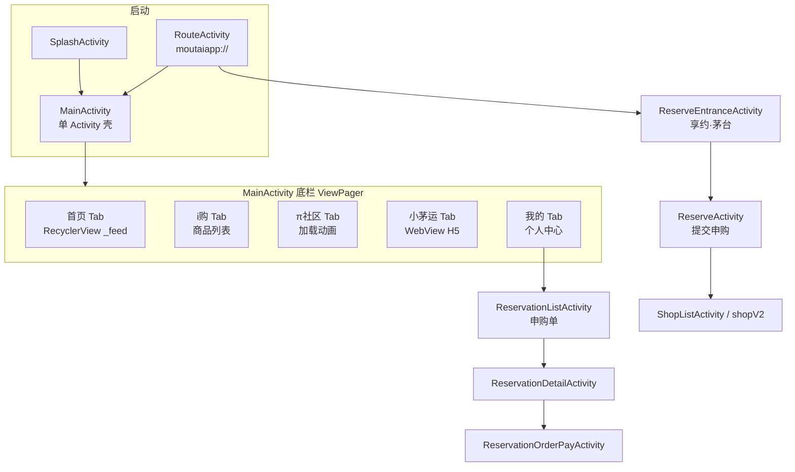

# i茅台 App 页面逆向（1.9.7 · 真机 ADB + Manifest）

> **设备**：WIKO JLG-AN00 · Android 14 · `com.moutai.mall` 1.9.7  
> **方法**：`uiautomator dump` + 截图 + `androguard` 解析 Manifest + assets 深链  
> **产物目录**：`reverse/tmp/ui_explore/`、`reverse/tmp/manifest_activities.json`  
> **一键复采**：`bash reverse/scripts/ui_reverse_explore.sh`

---

## 1. 总体架构



| 层级 | 技术 | 说明 |
|------|------|------|
| 主壳 | **原生 View + ViewPager** | `MainActivity` + `vp_main` + `tab_main` |
| 首页/i购/我的 | **RecyclerView + DataBinding** | 可见 `rv_list`、`databinding` 布局名 |
| π社区 | 原生占位 → 内容异步 | 仅 `ivGif` 加载态（非 Compose 独占） |
| 小茅运 | **WebView** | `com.moutai.mall:id/web_view`，H5 游戏 |
| 享约申购 | 独立 Activity | `ReserveEntranceActivity` |
| 部分运营页 | WebViewActivity | H5 容器 `webview.view.WebViewActivity` |

**更正**：DEX 含大量 `androidx.compose` 引用，但 **底栏 5 Tab 主流程以原生 View 为主**；Compose 多用于部分子模块/新版本块。

---

## 2. 底栏导航（真机 UI 实测）

| Tab | 文案 | resource-id | 容器 |
|-----|------|-------------|------|
| 0 | 首页 | `tab_name` / `vp_main` page 0 | `rv_list` 信息流 |
| 1 | i购 | 同上 page 1 | `hsv_category` + 商品 `rv` |
| 2 | π社区 | page 2 | `ivGif` 加载 |
| 3 | 小茅运 | page 3 | `web_view` |
| 4 | 我的 | page 4 | 订单/服务网格 |

**ADB 点击坐标**（720×1612）：首页 `(72,1537)` · i购 `(216,1537)` · π社区 `(360,1537)` · 小茅运 `(504,1537)` · 我的 `(648,1537)`

---

## 3. 各 Tab 页面要素

### 3.1 首页

| 区块 | 关键 ID / 文案 |
|------|----------------|
| 顶栏 | `layoutQR` 扫一扫 · `layoutMessage` 消息 |
| Banner | `vpHomeBanner` 轮播 |
| 我的i茅台 | `clStatistics` · 小茅运 `tvAmount` · 耐力值 `tvAmount` |
| 商品区 | `tvTitle` 品质·茅台 · `tvTips` 更多商品 |

### 3.2 i购（商城，非申购主入口）

| 元素 | 说明 |
|------|------|
| `hsv_category` | 顶部分类横滑 |
| `refreshLayout` | 下拉刷新商品 |
| `goods_pic` / `name` | 商品卡片（例：飞天 53%vol ¥1539） |
| `flShopCart` | 购物车入口 |

> **注意**：日常「申购」不在 i购 Tab，而在 **享约·茅台**（深链或运营位进入）。

### 3.3 π社区

- 当前仅见 `ivGif` + `vShadow`（内容未加载完或非申购日空态）
- 社区详情页：`NoteDetailActivity`、`CommunityUserHomeActivity` 等（Manifest）

### 3.4 小茅运（H5）

- `MainActivity` 内嵌 `web_view`
- 点击底栏「我的小茅运」会进 H5；**USB 调试开启时**可能触发 Everisk 弹窗：
  - 文案：**「当前设备异常，i茅台无法运行！」**
  - Activity：`com.bangcle.everisk.core.c`
- 对应本仓库 API：`IMaotaiClient.run_travel()` → `h5.moutai519.com.cn/game/...`

### 3.5 我的

| 入口 | 跳转 Activity | 实测文案 |
|------|---------------|----------|
| 我的申购单 | `ReservationListActivity` | 「您今天没有预约申购哦」 |
| 我的小茅运 | WebView / H5 | 可能触发风控弹窗 |
| 全部订单 | `OrderListActivity` | 待付款/待提货/待收货/待评价 |
| 小茅权益屋 | 外链或 WebView | — |
| 用户信息 | `PersonalInfoActivity` | 脱敏姓名、小茅运/耐力 |

---

## 4. 申购核心页面链（合同相关）

| 顺序 | Activity | 作用 | 深链 / 入口 |
|------|----------|------|-------------|
| 1 | `ReserveEntranceActivity` | **享约·茅台** 倒计时/场次 | `moutaiapp://reservationentrance` |
| 2 | `SelectReservationListActivity` | 选择申购商品 | 场次开放后 |
| 3 | `ReserveActivity` | **提交申购**（选门店+确认） | — |
| 4 | `ShopListActivity` / `shopV2.*` | 门店列表/切换/偏好 | `NearbyShopListActivity` 等 |
| 5 | `ReservationListActivity` | 申购单列表 | 我的 → 我的申购单 |
| 6 | `ReservationDetailActivity` | 单笔申购详情/中签 | — |
| 7 | `ReservationOrderPayActivity` | 中签后付款 | — |
| 8 | `PayResultActivity` / `MtPayActivity` | 支付结果 | 银联/支付宝/茅台支付 SDK |

**非申购窗实测**（2026-06-06 01:52）：

- `ReserveEntranceActivity` 文案：**「本场申购已结束」** + 倒计时「距离下一场申购开启还有 7 小时 xx 分」
- 与 API `sessionId=0` **一致**

### assets 深链（`mtpopupview.json`）

```json
moutaiapp://homepage
moutaiapp://reservationIndexentrance
moutaiapp://reservationentrance
```

ADB 验证：

```bash
adb shell am start -a android.intent.action.VIEW \
  -d "moutaiapp://reservationentrance" com.moutai.mall
# → ReserveEntranceActivity
```

---

## 5. Manifest 页面全览（105 个 Activity）

已导出：`reverse/tmp/manifest_activities.json`

| 分类 | 数量 | 代表 |
|------|------|------|
| 预约申购 | 6 | `ReserveActivity`、`ReservationListActivity`… |
| 门店 | 12 | `ShopListActivity`、`shopV2.ChangeShopActivity`… |
| 支付 | 12 | `MtPayActivity`、`UPPayWapActivity`、支付宝 H5… |
| 登录/个人 | 15 | `LoginActivity`、`PersonalInfoActivity`… |
| 商城/订单/其他 | 60+ | `OrderListActivity`、`WebViewActivity`… |

**启动**：`SplashActivity`（LAUNCHER）→ `MainActivity`  
**路由**：`RouteActivity` 处理 `moutaiapp://`

---

## 6. 与本仓库软件对照

| App 页面 | 本仓库能力 | API/模块 |
|----------|------------|----------|
| 享约·茅台 / 提交申购 | CLI `main.py`、管理 App 预约 | `reservation/add`、`session/get` |
| 我的申购单 | Web 申购记录、中签同步 | `query_reservation_results` |
| 门店选择 | 门店 CDN 同步、库存排行 | `shop/list/slim`、`resource CDN` |
| 小茅运/旅行 | 养护任务 | `run_travel()` |
| 中签付款 | 付款工作台（**不代扣**） | `payments` API + 人工 App 付款 |
| 登录 | 管理 App 本机 4G 发码 | `login.py` / `send_vcode` |

---

## 7. 页面逆向局限

| 无法靠 UI dump 获取 | 原因 |
|---------------------|------|
| 预约提交 Request Header 全量 | Release 无 logcat 明文 |
| 申购窗内门店库存 UI 结构 | 当前场次未开放 |
| 小茅运 H5 内 DOM | WebView 内层需 HAR/Chrome inspect |
| `mtappconfig` 解密后 Tab 配置 | 密文热更新 |

**建议**：申购日 9:00–10:00 再跑 `ui_reverse_explore.sh`，并对 `ReserveActivity` 做第二次 dump；同时用 Reqable 导出 HAR。

---

## 8. 复现命令

```bash
# 申购窗全量 dump（默认等到 sessionId≠0）
bash reverse/scripts/ui_dump_reserve_window.sh --har

# 非申购窗预检
bash reverse/scripts/ui_dump_reserve_window.sh --force

# macOS 每天 08:58 自动 dump（需 USB 连接）
bash reverse/scripts/schedule_reserve_dump.sh install

# 解析 UI XML
.venv/bin/python reverse/scripts/parse_ui_dump.py reverse/tmp/ui_reserve_window/<时间戳>

# HAR 分析（Reqable 导出后）
.venv/bin/python reverse/scripts/analyze_har.py reverse/tmp/imaotai.har

# 深链直达申购入口
adb shell am start -a android.intent.action.VIEW \
  -d "moutaiapp://reservationentrance" com.moutai.mall
```

### 小茅运 H5 采集注意

| 方式 | 条件 |
|------|------|
| Reqable HAR | 全量 VPN、**不要**只勾 i茅台；搜索 `h5.moutai519` |
| 避免设备异常 | **USB 调试 + ADB 连接** 时点小茅运会弹 Everisk；可改无线 ADB 后拔线再操作 |
| 协议替代 | `IMaotaiClient.run_travel()` 直连 `h5.moutai519.com.cn/game/...` |
| Chrome inspect | Release 包通常无法 `chrome://inspect` |

---

*2026-06-06 · WIKO JLG-AN00 真机 + androguard Manifest*
